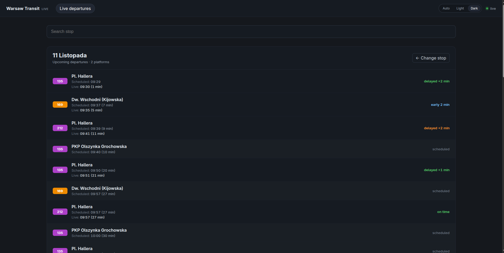
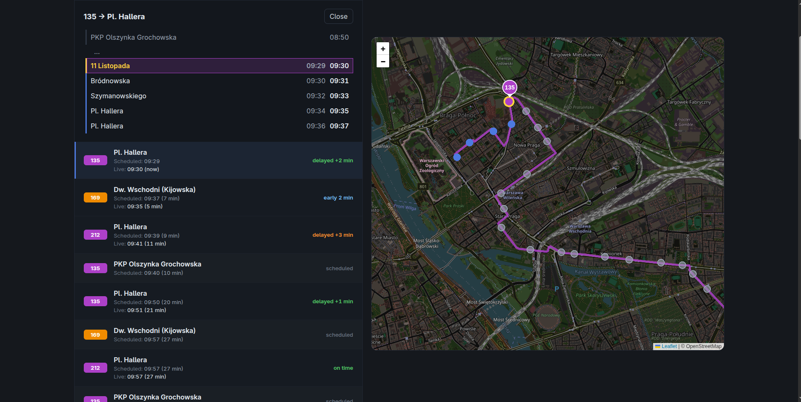

# Warsaw Transit Stream

A live public-transit backend for Warsaw, built with **Python 3.13**, **FastAPI**, **Apache Kafka**, **Apache Spark** and **PostgreSQL/PostGIS**, with **Redis** as the live-state store. It ingests real-time GPS pings from the ZTM API, matches them to scheduled GTFS trips, and serves live vehicle positions and stop departures over REST and WebSocket, with a React map frontend.

## Screenshots





## Tech stack

| Area | Choice |
|---|---|
| Language | Python 3.13 |
| API | FastAPI + Uvicorn, Pydantic, WebSocket |
| Messaging | Kafka (KRaft) via `confluent-kafka` |
| Stream processing | Apache Spark 4.3 Structured Streaming (PySpark, pandas, NumPy) |
| Static data | PostgreSQL 15 + PostGIS, GTFS timetable and version history |
| Live state | Redis 7 — hashes, sets, sorted sets, pub/sub |
| Data sources | ZTM Warszawa live vehicle API, GTFS feed from mkuran.pl |
| Schema | SQL init scripts mounted into PostgreSQL |
| Frontend | React 19 + Vite + TypeScript + Leaflet |
| Tests | pytest, Testcontainers (PostgreSQL, Redis), Vitest + Testing Library |
| Containers | Podman (`podman kube play`) — three pods on two networks |
| Runtime for Spark | Java 25 (CI) |
| CI | GitHub Actions — shared, pipeline, backend and web jobs |

## Architecture

A **hexagonal (ports and adapters)** architecture split into Python packages. Ports and domain models live in `core`, adapters implement them, and `composition` wires everything together:

```
waw_transit_pipeline  ──▶  waw_transit  ──▶  PostgreSQL / Redis
waw_transit_backend   ──▶  waw_transit

web  ──HTTP + WebSocket──▶  waw_transit_backend
```

```
waw_transit/
├── core/                  # models, errors, ports (interfaces)
├── config/                # environment loading and validation
└── database/              # PostgreSQL + Redis adapters

waw_transit_pipeline/
├── core/                  # pipeline ports and Kafka configuration
├── adapters/              # ZTM client, GTFS downloader, Kafka, Spark
├── ingest/                # polling the ZTM API into Kafka
├── gtfs/                  # GTFS download, parsing, loading, version sync
├── processing/            # Spark trip matching and Redis sink
├── supervisor/            # process supervision and restarts
└── composition/           # entry points for ingest, GTFS and processing

waw_transit_backend/
├── domain/                # read-side view models
├── application/           # query services and the Clock port
├── adapters/inbound/      # FastAPI HTTP routes and the WebSocket
└── composition/           # app factory and dependency container

web/                       # React + Vite + TypeScript frontend
infra/                     # Podman pod and SQL init scripts
tests/                     # mirrors the package layout
```

Rules:

- `core` contains no Kafka, Spark, HTTP or database code; adapters depend on ports, never the other way round.
- `waw_transit` is the only shared package: it holds the models and the PostgreSQL/Redis adapters used by both the pipeline and the backend.
- The backend is read-only. It never writes to PostgreSQL or Redis.
- The pipeline owns all writes: GTFS versions and timetable rows in PostgreSQL, live vehicles and departures in Redis.
- `python -m waw_transit_pipeline.main` is the only entry point. The supervisor loads the first timetable, then keeps `ingest`, `gtfs-watch` and `processing` alive with exponential backoff and a restart limit.

## Running with Podman

Requires Podman and `envsubst` (package `gettext`). Local development additionally needs Python 3.13, Java 25 and Node 22.

There are two modes:

| Script | Starts | Use |
|---|---|---|
| `infra/up.sh` | the full stack: PostgreSQL, Redis, Kafka, pipeline, backend, web | run everything |
| `infra/up-deps.sh` | only PostgreSQL, Redis and Kafka on host ports | local development |

Both modes share the `waw-transit-postgres-data` and `waw-transit-kafka-data` volumes, so never run them at the same time.

### Full stack

**1. Configure**

```bash
cd infra
cp .env.example .env
```

Fill in `DB_NAME`, `DB_USER`, `DB_PASSWORD`, `REDIS_PASSWORD`, `WARSAW_API_TOKEN` and `CLUSTER_ID`. A fresh Kafka cluster id can be generated with:

```bash
podman run --rm confluentinc/cp-kafka:7.5.0 kafka-storage random-uuid
```

**2. Start**

```bash
./up.sh
```

The script builds the three images, creates the `waw-pipeline` and `waw-api` networks, and starts the pods in order, waiting for PostgreSQL, Redis and Kafka before the next one.

| Service | Address |
|---|---|
| Frontend | http://localhost:8080 |

That is the only published port. Backend, PostgreSQL, Redis and Kafka are reachable only inside the stack.

**3. Stop and reset**

```bash
./down.sh                                              # keeps all project volumes
./down.sh && podman volume rm waw-transit-postgres-data waw-transit-kafka-data waw-transit-checkpoints   # fresh database, Kafka and Spark state
```

### Network isolation

```
Pod: waw-transit-infra       PostgreSQL, Redis       waw-pipeline + waw-api
Pod: waw-transit-pipeline    Kafka, pipeline         waw-pipeline
Pod: waw-transit-app         backend, web            waw-api
```

Only the infrastructure pod is attached to both networks, so the pipeline and the backend share PostgreSQL and Redis without seeing each other. Kafka stays inside the pipeline pod and is reached at `127.0.0.1:9092`. Inside the app pod, nginx proxies `/api` and `/ws` to the backend at `127.0.0.1:8000`.

### Dependencies only

For running the application yourself while Podman provides PostgreSQL, Redis and Kafka:

```bash
./up-deps.sh
```

| Service | Address |
|---|---|
| PostgreSQL + PostGIS | localhost:5432 |
| Redis | localhost:6379 (`REDIS_PORT`) |
| Kafka | localhost:9092 |

```bash
podman kube down pods/dependencies.yaml                                  # keeps the project volumes
podman kube down pods/dependencies.yaml && podman volume rm waw-transit-postgres-data   # fresh database
```

Then, with `WARSAW_API_TOKEN` and the matching `DB_*` / `REDIS_*` values in the root `.env`:

```bash
python -m venv .venv
source .venv/bin/activate
pip install -e ./waw_transit -e ./waw_transit_pipeline -e ./waw_transit_backend
pip install -r requirements-dev.txt

python -m waw_transit_pipeline.main     # GTFS sync, ingest and Spark processing
python -m waw_transit_backend.main      # API on http://localhost:8000

cd web
npm ci
npm run dev                             # http://localhost:5173, proxies to port 8000
```

The first GTFS load downloads and parses the whole Warsaw feed, so it takes a few minutes. Later starts reuse the active PostgreSQL version.

## Configuration

Container mode reads `infra/.env`; running the packages directly reads the root `.env` or exported environment. Required variables have no default.

| Variable | Default | Purpose |
|---|---|---|
| `WARSAW_API_TOKEN` | — | ZTM API token |
| `FETCH_INTERVAL_SECONDS` | `15` | how often ingest polls ZTM |
| `DB_HOST` / `DB_PORT` | `127.0.0.1` / `5432` | PostgreSQL address |
| `DB_NAME` | `warsaw_transit` | database name |
| `DB_USER` / `DB_PASSWORD` | — | database credentials |
| `DB_SCHEMA` | `public` | schema read by the timetable queries |
| `REDIS_HOST` / `REDIS_PORT` | `127.0.0.1` / `6379` | Redis address |
| `REDIS_PASSWORD` | empty | Redis password |
| `REDIS_DB` | `0` | Redis database |
| `KAFKA_BOOTSTRAP_SERVERS` | `127.0.0.1:9092` | broker address |
| `KAFKA_CLIENT_ID` | `warsaw-transit` | producer and consumer client id |
| `KAFKA_STARTING_OFFSETS` | `latest` | Spark starting offsets |
| `KAFKA_TOPIC_BUSES` | `warsaw_transit_buses_raw` | bus ping topic |
| `KAFKA_TOPIC_TRAMS` | `warsaw_transit_trams_raw` | tram ping topic |
| `KAFKA_TOPIC_GTFS_VERSION` | `warsaw_transit_gtfs_versions` | timetable version events |
| `TIMEZONE` | `Europe/Warsaw` | service time zone and Spark session zone |
| `SPARK_CHECKPOINT_LOCATION` | `./var/checkpoints/transit_stream` | streaming checkpoint |
| `PROCESSING_STATS_ENABLED` | `false` | print matching statistics per batch |
| `JAVA_HOME` | — | optional Java location for Spark |
| `LOCAL_IP` / `LOCAL_HOSTNAME` | — | optional Spark bind overrides |

`infra/.env` additionally holds the PostgreSQL credentials, `REDIS_PORT`, `REDIS_PASSWORD`, `CLUSTER_ID` and the `KAFKA_*` KRaft settings used by the pod; `infra/.env.example` contains working defaults.

In container mode `TZ` is set from `TIMEZONE`. Local runs need `TZ=Europe/Warsaw` too when the host is in another zone, because Spark returns naive timestamps in the process time zone.

## API

Locally the backend listens on `http://localhost:8000`. In the full stack only nginx is published: HTTP goes through `http://localhost:8080/api`, WebSocket through `ws://localhost:8080/ws`.

| Method | Path | Returns |
|---|---|---|
| `GET` | `/health` | `{"status": "ok"}` |
| `GET` | `/vehicles` | all live vehicles |
| `GET` | `/vehicles/{vehicle_id}` | one live vehicle |
| `GET` | `/stops?query=` | stops, optionally filtered by name |
| `GET` | `/stops/{stop_id}` | one stop |
| `GET` | `/stops/{stop_id}/departures?limit=20` | live and scheduled departures |
| `GET` | `/lines` | lines present in the timetable |
| `GET` | `/lines/{vehicle_type}/{line}/vehicles` | live vehicles on one line |
| `GET` | `/trips/{trip_id}/stops?date=YYYY-MM-DD` | ordered stops with scheduled times |
| `GET` | `/trips/{trip_id}/shape` | road shape of the trip |

Unknown vehicles and stops return `404`; when PostgreSQL or Redis is unreachable the API answers `503`. Both use `{"detail": "..."}`.

### OpenAPI

FastAPI generates the schema from the routes and response models:

- Swagger UI — http://localhost:8000/docs
- ReDoc — http://localhost:8000/redoc
- OpenAPI JSON — http://localhost:8000/openapi.json

These are served by the backend directly. In the full stack nginx does not expose them.

### WebSocket

The client opens `/ws` and sends `{"type": "subscribe", "stop_id": null, "line": null}`; the backend replies with a `snapshot` and then `update` messages at most once per second. `stop_id` adds departures, `line` filters vehicles, and `version` is the active GTFS version.

## Pipeline

`python -m waw_transit_pipeline.main` starts a supervisor: it first loads GTFS, then keeps three processes alive with backoff.

- `ingest` polls the ZTM bus and tram APIs every 15 s and publishes raw pings to two Kafka topics.
- `gtfs-watch` downloads the GTFS zip with `ETag`/`Last-Modified`, stores today and tomorrow, and publishes a version event when the feed changes.
- `processing` reads the topics with Spark Structured Streaming, drops pings older than 3 minutes, matches each vehicle to a trip by projected geometry, delay and heading, and resolves trip ownership when two vehicles compete.
- The matched state is written to Redis; a new GTFS version reloads the timetable lookup and restarts the stream.

## Frontend

React + Vite + TypeScript with Leaflet. Stops are searched by name and platforms sharing a name are merged. REST provides the initial data, WebSocket keeps vehicles and departures fresh, and the map draws the selected trip shape, its stops and the live vehicle. Vite proxies `/api` and `/ws` to port 8000 in development.

## Testing

```bash
python -m pytest tests/waw_transit
python -m pytest tests/waw_transit_pipeline
python -m pytest tests/waw_transit_backend

cd web
npm test
npm run build
```

Pipeline tests use Testcontainers with Redis and Redpanda for Kafka, Spark runs locally, and the backend tests use PostgreSQL and Redis containers. CI runs the shared and pipeline tests, a backend import check, and the frontend tests and build.

## Data sources and attribution

Live vehicle positions come from the Warsaw public API (`get_ztm_lokalizacja_pojazdow`, https://api.um.warszawa.pl). The City of Warsaw requires credit as **Miasto Stołeczne Warszawa**, together with the data download time and a link to https://api.um.warszawa.pl. The application fetches the data continuously; each record keeps its source timestamp (`Time`, stored as `api_timestamp`) and each ingest cycle time is logged. The data is processed: pings are matched to scheduled trips, delays are calculated and the result is served by this API. The City of Warsaw's reuse terms also ask reusers to notify `BG-informacjapubliczna@um.warszawa.pl` about any processing of the data.

Schedules come from the Warsaw GTFS feed published by Mikołaj Kuranowski at https://mkuran.pl/gtfs/warsaw.zip, built from ZTM Warszawa data. The feed's `attributions.txt` requires these credits:

- Data provided by: **Zarząd Transportu Miejskiego w Warszawie** — https://ztm.waw.pl
- GTFS provided by: **Mikołaj Kuranowski** — https://mkuran.pl/gtfs/
- Bus shapes based on data from **© OpenStreetMap contributors** (under the ODbL license) — https://www.openstreetmap.org/copyright

Static schedule data is used under the ZTM Warszawa data usage terms, with bus shapes under ODbL. The application modifies the source data by filtering, matching and aggregating it. It is not affiliated with or endorsed by ZTM Warszawa, the City of Warsaw, Mikołaj Kuranowski or OpenStreetMap.

## License

The source code is released under the MIT License. See [LICENSE](LICENSE).

The data is not covered by the code license. Live data belongs to the City of Warsaw, and the timetable and shape data retain the terms described above.
